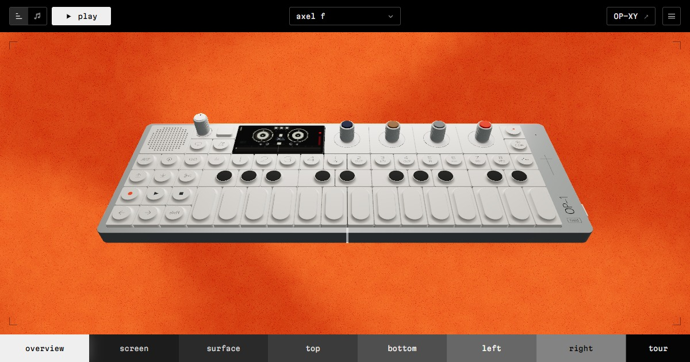
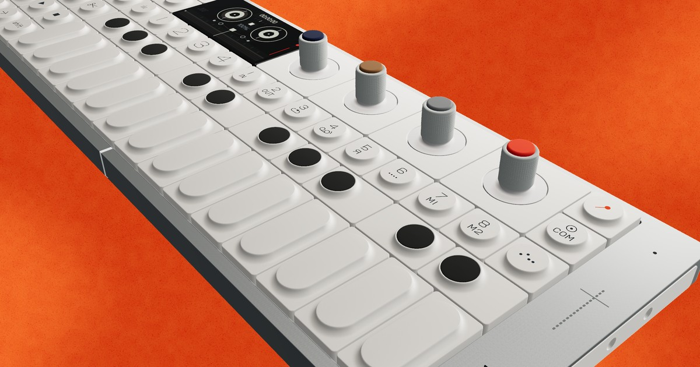

# OP-1 Field | Interactive Study

An interactive browser version of the Teenage Engineering OP-1 Field. Play the instrument, shape sounds, record to four-track tape and explore its physical details in 3D.

**[Open OP-1 Field](https://mitchivin.github.io/te-op1-field/) · [Explore OP-XY](https://mitchivin.github.io/te-opxy/)**

Free to use. Works on desktop and phone.

## Features

- **Playable device.** Keys, buttons and encoders respond, with a live device display.
- **Sound engines.** Synth and drum engines, editable samplers and effects.
- **Your own sounds.** Import a sound of up to 6 seconds to play from the keys.
- **Four-track tape.** Record, edit, play back and mix four stereo tracks, up to six minutes long.
- **Mixdown.** Download side A or side B as an audio file.
- **Featured arrangements.** Axel F, Halloween Theme, Popcorn, Stranger Things and Veridis Quo, played on the study's own instruments and tape.
- **Two ways to play a track.** Choose the wrench icon (**Watch build**) to see the track built step by step, or the musical-note icon (**Full song**) to hear it straight through.
- **Camera views.** Move between the screen, the controls and the hardware details.

## Keyboard

| Key | Action |
| --- | --- |
| 1 to 4 | Synth, Drum, Tape or Mixer |
| Space | Play the tape |
| R | Record |
| T | Tempo |
| P | Power |
| I | Hide the on-screen controls (desktop) |

## Get started

1. Open [OP-1 Field](https://mitchivin.github.io/te-op1-field/).
2. Choose a song. Choosing a song starts it.
3. Use the transport to stop, pause or resume, or play the keys yourself.

This is a browser interpretation with simulated sound and workflows. It is not official firmware or a complete hardware emulator.

This repository hosts the compiled website and public project information. The application source is not published here.

## Related

- [DoodleDev](https://github.com/mitchivin/doodledev)
- [iPod Classic](https://github.com/mitchivin/ipod-classic)
- [iPod Original](https://github.com/mitchivin/ipod-original)
- [Game Boy Color](https://github.com/mitchivin/game-boy-color)
- [OP-XY](https://github.com/mitchivin/te-opxy)
- [Frostbolt Player](https://github.com/mitchivin/frostbolt-player)
- [MitchIvin XP](https://mitchivin.com/)

## About

Built by [Mitch Ivin](https://mitchivin.com/). An independent creative project inspired by the Teenage Engineering OP-1 Field, with no affiliation to Teenage Engineering.

Screenshots captured at 1200 × 630.
